**Mobile, web and backend, built for real users and hardened against real attackers.**

Ankara, Türkiye &nbsp;·&nbsp; Founder of [HaideraLabs](https://haideralabs.site)

**Open to engineering roles and select freelance.** Ankara, Istanbul, Qatar or remote.

 

## At a glance

|  |  |
| :-- | :-- |
| **Now** | Founder and lead engineer, [Diwan Türkiye](https://diwanturkiye.app) |
| **Studio** | [HaideraLabs](https://haideralabs.site): AI agents, automations and business websites for clients |
| **Education** | B.Sc. Software Engineering, Atılım University (2020 to 2026) |
| **Experience** | Software Engineering Intern, SS4IT, Riyadh (2026) · Web Development Intern, Scramblebit, Istanbul (2024) |
| **Languages** | Arabic (native) · English (professional) · Turkish (intermediate). Ships apps in all three, including right-to-left layouts. |

 

## Selected work

| Project | What it is |
| :-- | :-- |
| **[Diwan Türkiye](https://ahmedhaidar.me/work/diwan-turkiye)** | Guide app for the parts of living in Türkiye nobody explains: residence-permit guides with real fees and payment codes, emergency help, universities and community answers. Free on iOS and Android. Backend moved from Firebase to self-hosted Supabase on a Linux VPS, behind Caddy, with scripted deploys, database backups and hardening. |
| **[NoteVault](https://ahmedhaidar.me/work/notevault)** | Security case study. Started deliberately vulnerable; a threat model, Semgrep and OWASP ZAP found eight issues, from a critical IDOR to CSP wildcards. Seven fixed, one shown not to be exploitable, then scanned again. |
| **[DRAPO](https://ahmedhaidar.me/work/drapo)** | Patient-first healthcare reviews with a weighted ranking engine. |
| **[HalaHome](https://ahmedhaidar.me/work/halahome)** | Hyperlocal marketplace for handmade crafts in Qatar. |
| **[Job Recommender](https://ahmedhaidar.me/work/job-recommender)** | AI-assisted job matching from a CV. |

More at **[ahmedhaidar.me/work](https://ahmedhaidar.me/work)**.

 

## Stack

| | |
| :-- | :-- |
| **Mobile** |     |
| **Frontend** |             |
| **Backend** |           |
| **Data** |         |
| **AI and automation** |       |
| **Architecture** |   |
| **Cloud, testing and delivery** |             |
| **Security** |    |
| **Methods** |   |

 

*Make it work. Make it right. Make it hold.*

**[Get in touch](mailto:ahm3dbusinesss@gmail.com)** &nbsp;·&nbsp; **[Portfolio](https://ahmedhaidar.me)** &nbsp;·&nbsp; **[Writing](https://ahmedhaidar.me/writing)**

